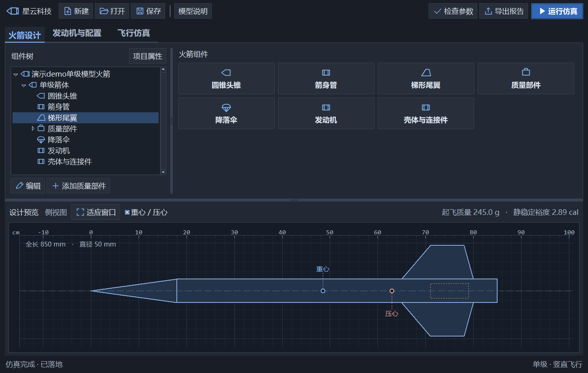

# 模型火箭设计与仿真

一款中文 Windows 桌面应用，用于单级模型火箭的初步设计和飞行仿真。你可以在一个项目中编辑箭体与质量分布，输入发动机数据，检查结构与静稳定性，并查看从离轨到开伞、落地的计算结果。



## 快速开始

1. 从 [GitHub Releases](https://github.com/baimo0001/RocketFlightSimulater/releases/latest) 下载并解压 Windows 便携包，运行 `NebulaRocket.exe`。请将它和 `_internal` 文件夹保留在一起。
2. 应用会打开演示项目。点击右上角的 **运行仿真**，或按 `F5`。
3. 在 **飞行仿真 → 结果与曲线** 查看高度、速度、发动机曲线、静稳定和事件时间。
4. 点击 **保存** 生成可继续编辑的 JSON 项目。点击 **导出报告** 生成 HTML、PNG、CSV 和 JSON 文件。

## 工作区

| 页面 | 用途 |
| --- | --- |
| 火箭设计 | 编辑头锥、箭身、尾翼和质量部件。侧视图标记重心和压心，选中组件时高亮对应部位。 |
| 发动机与配置 | 导入 CSV、RASP `.eng` 推力曲线，或使用准稳态计算模式。 |
| 飞行仿真 | 设置发射海拔、导轨、回收与求解条件，查看飞行曲线、关键指标和事件。 |

`examples/` 包含 [推力曲线演示项目](examples/教学演示.json)、[内弹道演示项目](examples/内弹道演示.json) 和 [CSV 示例](examples/推力曲线示例.csv)。字段、单位和报告文件的详细说明见 [使用指南](docs/USAGE.md)。

## 从源码运行

在 Windows PowerShell 中进入项目目录，使用 Python 3.10 创建环境：

```powershell
py -3.10 -m venv .venv
.\.venv\Scripts\python.exe -m pip install -r requirements.txt
.\.venv\Scripts\python.exe app.py
```

无界面复算并导出报告：

```powershell
.\.venv\Scripts\python.exe app.py --project examples/教学演示.json --run --export validation/demo-report
```

开发、打包和改动提交说明见 [开发指南](docs/DEVELOPMENT.md)。测试方法与误差说明见 [验证指南](docs/VALIDATION.md)。

## 适用范围

飞行模型采用单级、无风、一维竖直运动，适用于亚声速初步分析。静稳定计算采用圆锥头锥、等直径箭身和 3 或 4 片梯形尾翼的近似。常数阻力系数、瞬时开伞及简化结构校核的适用条件见 [模型说明](docs/MODELS.md)。
